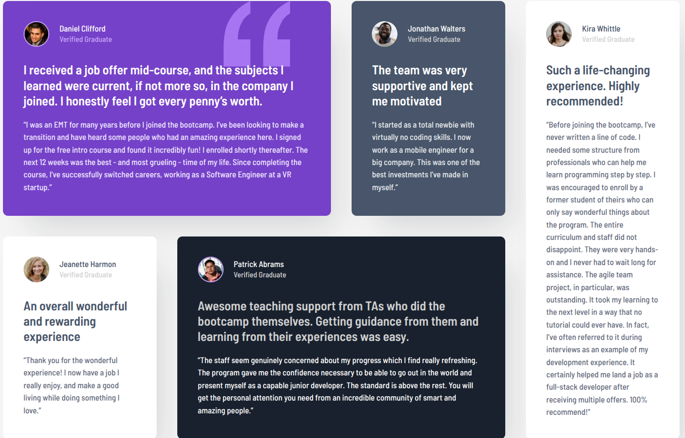

# Frontend Mentor - Testimonials grid section solution

This is a solution to the [Testimonials grid section challenge on Frontend Mentor](https://www.frontendmentor.io/challenges/testimonials-grid-section-Nnw6J7Un7). Frontend Mentor challenges help you improve your coding skills by building realistic projects.

## Table of contents

- [Overview](#overview)
  - [The challenge](#the-challenge)
  - [Screenshot](#screenshot)
  - [Links](#links)
- [My process](#my-process)
  - [Built with](#built-with)
  - [What I learned](#what-i-learned)
  - [Continued development](#continued-development)
  - [AI Collaboration](#ai-collaboration)
- [Author](#author)

## Overview

### The challenge

Users should be able to:

- View the optimal layout for the section depending on their device's screen size

### Screenshot



### Links

- Solution URL: [https://github.com/mth-ani/testimonial-grid-section](https://github.com/mth-ani/testimonial-grid-section)
- Live Site URL: [https://mth-ani.github.io/testimonial-grid-section/](https://mth-ani.github.io/testimonial-grid-section/)

## My process

### Built with

- Semantic HTML5 markup
- CSS custom properties
- Flexbox
- CSS Grid
- Mobile-first workflow

### What I learned

This project taught me how to build an uneven grid. The desktop layout uses four equal columns, and some cards span more than one column or row. Here is how I placed the cards:

```css
.daniel-testimonial {
  grid-column: 1 / 3;
}

.patrick-testimonial {
  grid-column: 2 / span 2;
}

.kira-testimonial {
  grid-column: 4;
  grid-row: 1 / span 2;
}
```

Jonathan and Jeanette didn't need any placement. Once the other cards were set, the grid filled in the remaining spots automatically.

Other things I picked up:

- Using the `.sr-only` pattern to hide the page's `h1` visually while keeping it available to screen readers, instead of `display: none`
- Marking up each testimonial with `article`, an `h2` for the headline and a `blockquote` for the quote
- Using `alt=""` on avatars, since the name already sits beside each image
- Using the `background` shorthand resets the background color, so I used `background-image`, `background-repeat` and `background-position` to add the quote mark to Daniel's card without losing its purple
- Writing the `&rsquo;`, `&ldquo;` and `&rdquo;` entities so special characters don't break with the wrong file encoding

### Continued development

I want to get more comfortable with CSS Grid, including `grid-template-areas`, and with reducing repeated CSS, for example by using a shared class or custom properties for the per-card colors. I also want to add a tablet breakpoint, since the layout currently jumps straight from one column to four.

### AI Collaboration

I used Claude as a mentor while building this project. Instead of asking it to write the code, I asked for hints, explanations and reviews of my HTML and CSS, then wrote everything myself.

- **What worked well:** getting my HTML structure reviewed (heading levels, alt text, `blockquote`), working out the grid layout step by step, and spotting mistakes such as the `background` shorthand wiping out the card color.
- **What didn't:** pixel measurements and color choices taken from the design were only estimates, so I still had to compare my result with the design in dev tools and adjust by eye.

## Author

- GitHub - [@mth-ani](https://github.com/mth-ani)
- Frontend Mentor - [@mth-ani](https://www.frontendmentor.io/profile/mth-ani)
